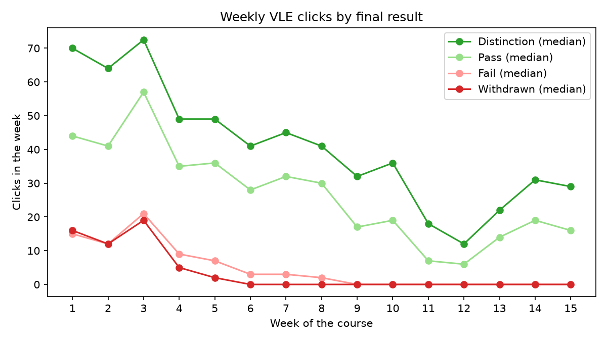
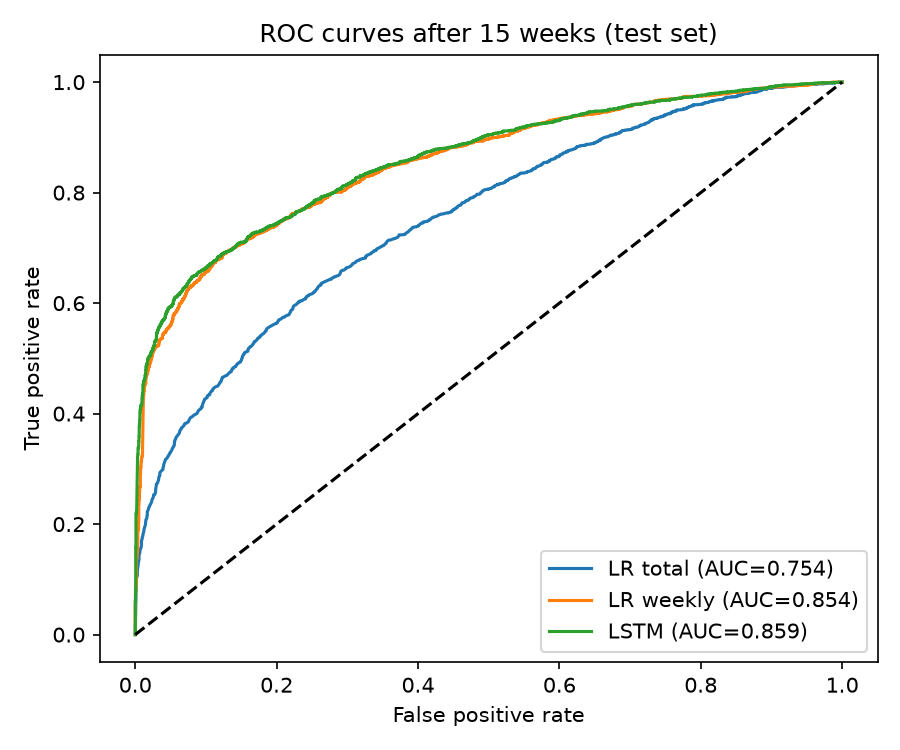
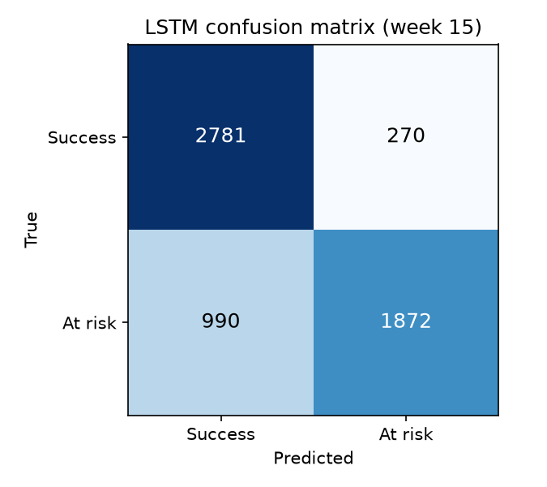
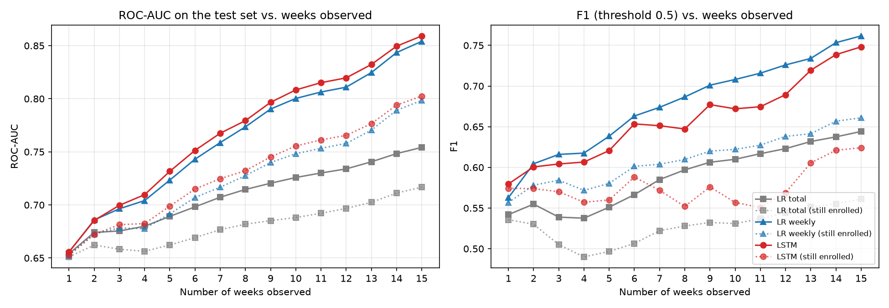
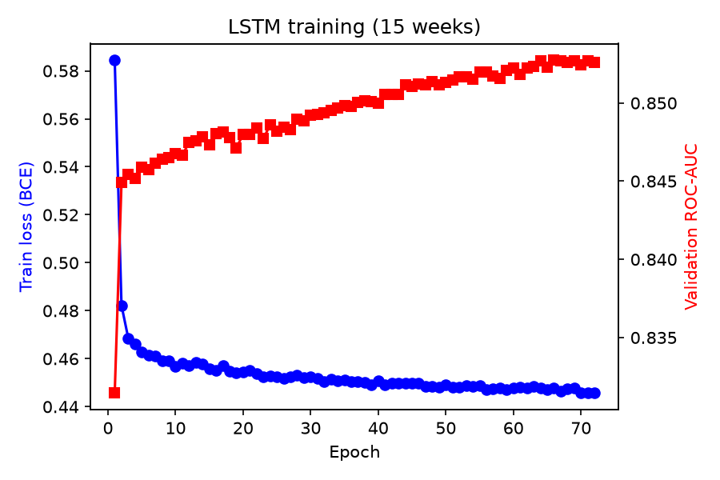

# Learner Dropout Prediction with an LSTM (OULAD)

Can we tell, **a few weeks into an online course**, which students will withdraw or fail —
using nothing but how often they click on the course website each week?
This project compares simple logistic-regression baselines with a small LSTM
(PyTorch, CPU only) and measures **how prediction quality grows week after week**.

## Data

**OULAD — Open University Learning Analytics Dataset**
(Kuzilek, Hlosta & Zdrahal, *Scientific Data* 4, 170171, 2017), licence **CC BY 4.0**.
22 module presentations (7 modules, 2013–2014), 32,593 student enrolments,
10,655,280 click records (student × resource × day) on the virtual learning environment (VLE).

The data is **not included** in this repository. `src/download_data.py` downloads it
automatically (≈ 47 MB zip, ≈ 460 MB unzipped) into `data/raw/`. The historical Open University
download link currently returns 404, so the script falls back to the identical copy on the
[UCI Machine Learning Repository (id 349)](https://archive.ics.uci.edu/dataset/349).

Files used: `studentInfo.csv` (final result), `studentRegistration.csv` (unregistration day),
`studentVle.csv` (clicks per student, resource and day).

## Method

**Target.** `final_result` has four values. We predict a binary label:

| label | final_result | after filtering |
|---|---|---|
| 1 = **at risk** | Withdrawn, Fail | 14,111 (47.8 %) |
| 0 = success | Pass, Distinction | 15,385 (52.2 %) |

*Why group Withdrawn with Fail?* From a teacher's point of view both outcomes mean the
student did not complete the module successfully and would have benefited from early
contact. Both groups also show the same early click pattern (figure below), and the
grouping gives balanced classes. Distinction is grouped with Pass for the same reason.

**Filtering.** 3,097 enrolments were cancelled **before the course started** (day ≤ 0).
They never had a chance to click, so predicting them would be trivial and useless;
they are removed (29,496 enrolments remain).

**Sequences.** For each enrolment and each of the first **15 weeks** (days 0–104,
≈ 40 % of a 9-month module) we compute two numbers: total clicks of the week (log-scaled)
and number of active days (0–7). Weeks without activity are 0.



**Split.** 70 / 10 / 20 % train / validation / test, **grouped by student id** so that a
student enrolled in two modules never appears in both train and test
(20,620 / 2,963 / 5,913 enrolments).

**Models**, re-trained for every horizon *w* = 1 … 15 weeks:

| Model | Input | Notes |
|---|---|---|
| LR total (required baseline) | total clicks of weeks 1..w (1 number) | logistic regression |
| LR weekly | the 2·w weekly values, flattened | same information as the LSTM, but no notion of order |
| **LSTM** | sequence of w weeks × 2 features | 1 layer, 32 hidden units, dropout 0.2, Adam (lr 1e-3), batch 256, early stopping on validation ROC-AUC (patience 8, max 80 epochs) |

Metrics on the test set: accuracy, F1 (threshold 0.5) and ROC-AUC.
Seeds are fixed (42). Full run: **≈ 7 minutes on a laptop CPU** (i7-1365U).

## Results

### Main comparison (test set, 5,913 enrolments)

| Weeks observed | Model | Accuracy | F1 | ROC-AUC |
|---|---|---:|---:|---:|
| 5 | LR total | 0.627 | 0.551 | 0.689 |
| 5 | LR weekly | 0.663 | **0.638** | 0.723 |
| 5 | LSTM | **0.670** | 0.621 | **0.732** |
| 10 | LR total | 0.665 | 0.610 | 0.726 |
| 10 | LR weekly | 0.720 | **0.708** | 0.800 |
| 10 | LSTM | **0.730** | 0.672 | **0.808** |
| 15 | LR total | 0.686 | 0.644 | 0.754 |
| 15 | LR weekly | 0.768 | **0.762** | 0.854 |
| 15 | LSTM | **0.787** | 0.748 | **0.859** |

(all 15 weeks: [`outputs/performance_by_week.csv`](outputs/performance_by_week.csv))




### From which week is the model useful?



- **Week 1** already gives ROC-AUC ≈ 0.65 for every model: students who barely open the
  course in the first week are more often at risk.
- The LSTM passes **ROC-AUC 0.75 at week 6** (0.751) and **0.80 at week 10** (0.808).
  The weekly logistic regression reaches the same levels about one week later or at the same week
  (0.759 at week 7, 0.800 at week 10). The "total clicks" baseline only reaches 0.754 at week 15.
- **Honest view (dotted lines):** many at-risk students have *already unregistered* by week *w*,
  and those are easy to detect (zero clicks). If we evaluate only students **still enrolled at
  the end of week w**, the scores are lower: LSTM ROC-AUC 0.699 at week 5, 0.755 at week 10,
  0.803 at week 15 (LR weekly: 0.692 / 0.748 / 0.798). This is the number that matters for an
  intervention, since a teacher can only contact students who are still there.

### What did we learn?

1. **The timing of activity matters more than its amount.** Going from total clicks (LR total)
   to week-by-week clicks (LR weekly) is the big jump: +0.074 ROC-AUC at week 10.
2. **The LSTM adds only a little** on top of the weekly logistic regression:
   +0.004 to +0.009 ROC-AUC from week 3 on, and a lower F1 at the default 0.5 threshold
   (it predicts "at risk" less often). With only 2 features per week, a linear model on the
   weekly vector already captures most of the signal; the LSTM would matter more with richer
   weekly inputs (resource types, assessment scores) or longer sequences.



## How to run

```bash
python -m venv .venv
.venv\Scripts\activate                       # Windows (Linux/macOS: source .venv/bin/activate)
pip install -r requirements.txt --extra-index-url https://download.pytorch.org/whl/cpu
python src/run_experiments.py                # downloads OULAD if needed, then runs everything
```

Outputs: `figures/` (plots), `outputs/` (CSV/JSON results and the run log),
`models/lstm_week15.pt` (git-ignored), `data/` (git-ignored).

## Limitations

- **Clicks only.** No demographics, no assessment scores, no resource types: this is on purpose
  (the question is "what do clicks alone tell us?"), but real early-warning systems combine them.
- **Threshold 0.5 not tuned.** F1 depends on it; a school would choose a threshold according to how
  many students it can contact.
- **Random split by student, not by time.** Training and test enrolments come from the same
  module presentations. A stricter test would train on 2013 presentations and test on 2014.
- **Click counts are not normalised per module**, although modules have very different designs;
  per-module normalisation could help.
- **One run, one seed.** Differences of < 0.01 ROC-AUC between LR weekly and the LSTM are within
  what could change with another seed or split; they should not be over-interpreted.
- Data from one UK distance-learning university (2013–2014); results may not transfer elsewhere.

## Project structure

```
learner-dropout-lstm/
├── src/
│   ├── download_data.py    # gets OULAD (CC BY 4.0)
│   ├── dataset.py          # builds the weekly sequences
│   └── run_experiments.py  # baselines + LSTM, week-by-week evaluation, figures
├── figures/  outputs/
├── requirements.txt
├── EXPLICATION_FR.md       # step-by-step explanation in French
└── README.md
```

## Citation of the data

Kuzilek J., Hlosta M., Zdrahal Z. *Open University Learning Analytics dataset.*
Scientific Data 4, 170171 (2017). https://doi.org/10.1038/sdata.2017.171

Author of this analysis: Ilyas Benderrou.
